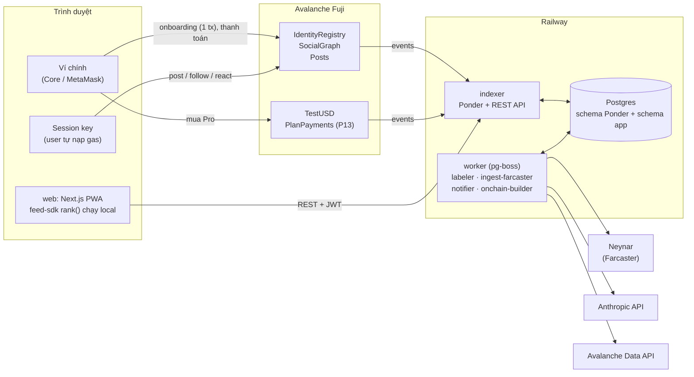
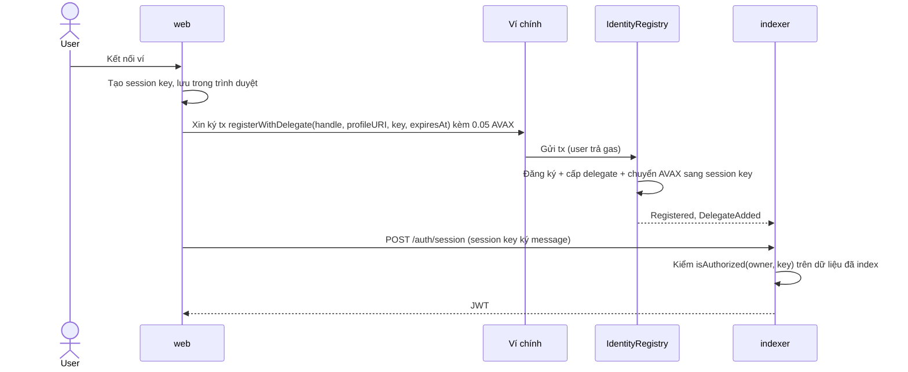
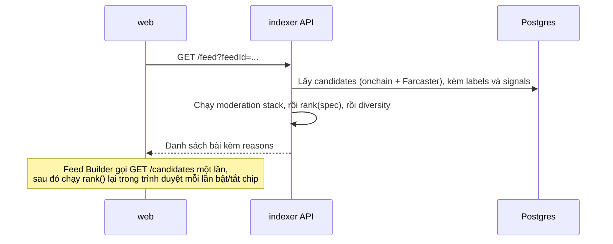

# Kiến trúc · bản đầu (trước P0)

> Bản thiết kế trước khi có code. Mục 6 (schema event) sẽ được chốt ở P1 [REVIEW]. File này cập nhật lại ở P8.
> Spec đầy đủ nằm trong `INIT_PROMPT.md`; các luật bắt buộc nằm trong `CLAUDE.md`.

## 1. Tổng quan

Danh tính và graph nằm onchain, trên Avalanche Fuji. Mọi thứ còn lại (index, gán nhãn, xếp hạng, giao diện) chạy offchain và **thay thế được**:
- Ai cũng replay được indexer từ chain.
- Labeler là plugin.
- Client fork được.

User tự trả gas qua session key của chính họ, nên hệ thống không có relayer.



## 2. Thành phần

| Thành phần | Trách nhiệm | Không làm |
|---|---|---|
| `contracts` | Identity, graph, posts (lõi, không admin); tUSD và thanh toán (của client) | Không lưu text, không lưu số đếm, không có admin ở lõi |
| `apps/indexer` | Dựng state từ event; REST API; chạy `rank()` cho `/feed`; xác thực JWT | Không gọi LLM, không tự gán nhãn |
| `apps/worker` | Gán nhãn (LLM/heuristic), ingest Farcaster, thông báo, kiểm tra builder onchain | Không phục vụ request của user |
| `apps/web` | UI, quản lý session key, Feed Builder (chạy `rank()` trong trình duyệt) | Không giữ secret phía server ngoài phần SSR |
| `packages/feed-sdk` | FeedSpec, nhãn, tín hiệu, `rank()`, `compileFeed()`, moderation | Không I/O (trừ `compileFeed` gọi LLM) |
| `packages/protocol` | ABI, địa chỉ theo chainId + version, helper session key | |
| `packages/db` | Drizzle schema `app` + migrations | Không đụng tới schema của Ponder |

## 3. Dữ liệu nằm ở đâu

| Dữ liệu | Nơi lưu | Dựng lại được? |
|---|---|---|
| Identity, handle, delegate, follow, bài native, reaction, tombstone | Event trên Fuji | Là nguồn gốc |
| Bảng index của các dữ liệu trên | Postgres, schema của Ponder | Có, bằng `pnpm indexer:replay` |
| Bài và user Farcaster | Postgres, schema `app` | Có, ingest lại từ Neynar |
| Nhãn bài và nhãn tác giả | Postgres, schema `app` | Có, lấy lại từ labeler (batch có chữ ký) |
| Feed cá nhân, quota, thông báo, báo cáo, danh sách chặn, `pending_follows`, `events` | Postgres, schema `app` | **Không**, nên phải backup |
| Thông tin profile (tên, bio, avatar) | JSON offchain, trỏ tới qua `profileURI` | Phụ thuộc nơi lưu |
| Bản sao công khai của graph và bài onchain | `pnpm snapshot:export` (JSON) | Phòng trường hợp Fuji gặp sự cố |

## 4. Xác thực và quyền

| Chủ thể | Làm được | Ký bằng |
|---|---|---|
| Ví chính (owner) | Đăng ký, quản lý session key, thanh toán, mọi việc delegate làm được | Ví người dùng (có popup) |
| Session key (delegate) | `post`, `react`, `unreact`, `deletePost`, `follow`, `unfollow`, `followMany`, `setProfile` | Key trong trình duyệt (không popup, tự trả gas) |
| JWT | Đọc dữ liệu riêng tư (thông báo, quota, feed cá nhân) | Server cấp sau khi session key ký message |



## 5. Luồng chính

**Đăng bài**
1. Session key gửi `Posts.post(as, …)` và tự trả gas.
2. Indexer bắt event `Posted`.
3. Worker đưa bài vào hàng đợi gán nhãn.
4. Bài xuất hiện trong feed của người follow.

**Đọc feed**


**Gán nhãn**
1. Worker nhận job.
2. Gom batch và gọi `LABELER_MODEL`; nội dung bài được coi là dữ liệu không đáng tin.
3. Validate bằng zod, kẹp điểm vào khoảng 0–1.
4. Ký batch, phát qua `/labels?since=`.
5. Indexer verify chữ ký rồi lưu.

Khi không có key thì dùng chế độ heuristic.

**Ingest Farcaster**
1. Worker tìm FID của user qua verified address.
2. Lấy bài của những người user follow và của các channel Avalanche.
3. Chuẩn hoá thành `fc:<hash>`, tác giả map về địa chỉ ETH.
4. Chỉ đưa vào hàng đợi gán nhãn những bài có khả năng lên feed.

**Thanh toán (P13)**
1. Ví chính ký permit, rồi gửi `PlanPayments.payWithPermit`.
2. Contract emit event `Paid`.
3. Indexer cập nhật `entitlements`.
4. Quota Pro có hiệu lực.

## 6. Schema event (bản nháp, chốt ở P1)

| Contract | Event | Field (dự kiến) |
|---|---|---|
| IdentityRegistry | `Registered` | owner, handle, profileURI |
| | `ProfileUpdated` | owner, profileURI |
| | `DelegateAdded` | owner, key, expiresAt |
| | `DelegateRemoved` | owner, key |
| SocialGraph | `Followed` / `Unfollowed` | follower, target |
| Posts | `Posted` | id, author, parentId, channel, text, meta, timestamp |
| | `Reacted` / `Unreacted` | actor, postId, kind |
| | `Deleted` | author, id |
| PlanPayments (P13) | `Paid` | user, planId, amount, paidUntil |
| FeedRegistry (GĐ2) | `FeedRegistered`, `FeedUpdated`, `Subscribed`, `Tipped` | xem INIT_PROMPT §6 |

Cần chốt ở P1:
- Mỗi event chọn tối đa 3 field `indexed`, sao cho client nhẹ (không có indexer) vẫn lọc log được. Ví dụ với `Posted`: author, channel, parentId.
- Có thêm field `signer` (session key nào đã ký) vào event hay không.

## 7. Feed engine

```
sources ──► moderation stack ──► rules của feed ──► diversity ──► [ { postId, score, reasons[] } ]
(onchain, Farcaster)  (hide/downrank, áp mọi feed)  (boost/downrank/hide)  (maxPerAuthor)
```

- Nhãn do LLM gán **lúc ghi**. Tín hiệu (`recency`, `conversation`, `onchain_builder`…) được tính từ dữ liệu.
- `rank()` là hàm thuần, dùng chung giữa indexer và trình duyệt.
- `compileFeed()` biến câu EN/VI thành FeedSpec trong tập nhãn đóng. Yêu cầu nào không map được thì trả về trong `unsupported`.

## 8. Môi trường

| Môi trường | Chain | Dịch vụ ngoài | Ghi chú |
|---|---|---|---|
| Local | Anvil | mock/fixture (không cần key) | `pnpm dev:local`, có seed data hư cấu |
| Fuji | Fuji (43113) | Neynar, Anthropic, Avalanche Data API | Bản chạy thật. Trước P8 được deploy lại contract; từ P8 đóng băng schema |

## 9. Giới hạn đã biết (chi tiết ở LIMITATIONS.md từ P8)

- Mất ví chính thì mất identity, chưa có cơ chế recovery.
- Dữ liệu onchain không xoá được: xoá bài chỉ tạo tombstone. Vì vậy không đưa thông tin cá nhân lên chain.
- Fuji là testnet: không có cam kết lưu dữ liệu vĩnh viễn (giảm thiểu bằng snapshot); test AVAX không có giá trị nên spam rẻ (giảm thiểu bằng feed và labeler).
- Doanh thu bằng tUSD chỉ là giả lập.

## 10. Câu hỏi mở về kỹ thuật

- Ponder có cho chạy custom Hono route với `@hono/zod-openapi`, và có sống chung với schema `app` trong cùng DB được không? (kiểm ở P2)
- Ponder và Next.js có chạy được trên Node 26 không? (kiểm ở P0)
- Có endpoint nào liệt kê các contract mà một địa chỉ đã deploy? (kiểm ở P7; đã có 3 phương án dự phòng)
- Tên chính xác của các channel Farcaster về Avalanche là gì? (kiểm ở P5)
