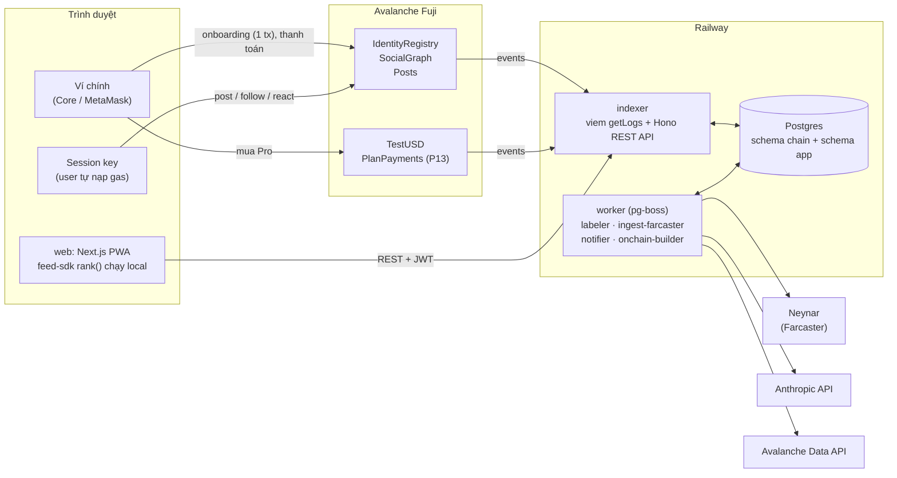
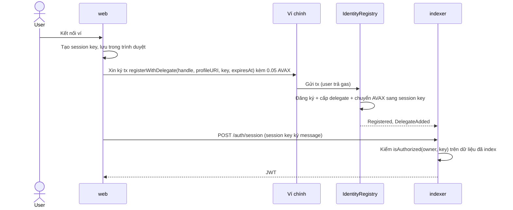
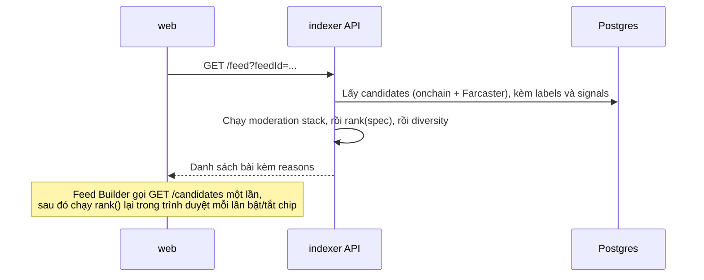
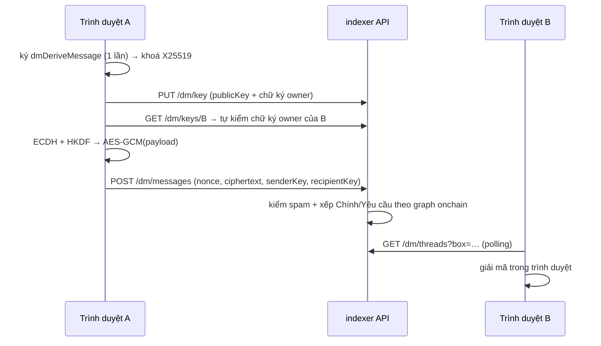

# Kiến trúc

> Cập nhật theo code (P0–P14, Giai đoạn 0–1). Schema event ở mục 6 là bản đã deploy; từ P8 coi là đóng băng.
> Spec đầy đủ nằm trong `INIT_PROMPT.md`; các luật bắt buộc nằm trong `CLAUDE.md`.

## 1. Tổng quan

Danh tính và graph nằm onchain, trên Avalanche Fuji. Mọi thứ còn lại (index, gán nhãn, xếp hạng, giao diện) chạy offchain và **thay thế được**:
- Ai cũng replay được indexer từ chain.
- Labeler là plugin.
- Client fork được.

User tự trả gas qua session key của chính họ, nên hệ thống không có relayer.



## 2. Thành phần

| Thành phần | Trách nhiệm | Không làm |
|---|---|---|
| `contracts` | Identity, graph, posts (lõi, không admin); tUSD và thanh toán (của client) | Không lưu text, không lưu số đếm, không có admin ở lõi |
| `apps/indexer` | Dựng state từ event; REST API; chạy `rank()` cho `/feed`; xác thực JWT | Không gọi LLM, không tự gán nhãn |
| `apps/worker` | Gán nhãn (LLM/heuristic), ingest Farcaster, thông báo, kiểm tra builder onchain | Không phục vụ request của user |
| `apps/web` | UI, quản lý session key, Feed Builder (chạy `rank()` trong trình duyệt) | Không giữ secret phía server ngoài phần SSR |
| `packages/feed-sdk` | FeedSpec, nhãn, tín hiệu, `rank()`, `compileFeed()`, moderation | Không I/O (trừ `compileFeed` gọi LLM) |
| `packages/protocol` | ABI, địa chỉ theo chainId + version, helper session key | |
| `packages/db` | Drizzle: schema `chain` (dựng lại được) + schema `app` (phải backup) + migrations | |
| `packages/farcaster` | Nguồn Farcaster: Neynar hoặc fixture | Chỉ đọc |
| `packages/llm` | Wrapper Anthropic SDK (cache system prompt, xử lý refusal/max_tokens) | |
| `packages/ui` | Icon + component React thuần dùng chung | Không phụ thuộc Next |

## 3. Dữ liệu nằm ở đâu

| Dữ liệu | Nơi lưu | Dựng lại được? |
|---|---|---|
| Identity, handle, delegate, follow, bài native, reaction, tombstone | Event trên Fuji | Là nguồn gốc |
| Bảng index của các dữ liệu trên | Postgres, schema `chain` | Có, bằng `pnpm indexer:replay` |
| Bài và user Farcaster | Postgres, schema `app` | Có, ingest lại từ Neynar |
| Nhãn bài và nhãn tác giả | Postgres, schema `app` | Có, lấy lại từ labeler (batch có chữ ký) |
| Feed cá nhân, quota, thông báo, báo cáo, danh sách chặn, `pending_follows`, `events` | Postgres, schema `app` | **Không**, nên phải backup |
| Tin nhắn riêng: **chỉ ciphertext**, khoá công khai nhắn tin (có chữ ký owner), trạng thái hộp thư | Postgres, `app.dm_keys`, `app.dm_messages`, `app.dm_threads` | Không (backup cùng schema `app`). Plaintext chỉ có trong trình duyệt hai người |
| Thông tin profile (tên, bio, avatar) | `app.profiles`, phục vụ ở `GET /profiles/{address}`; `profileURI` onchain trỏ tới đó | Không (backup cùng schema `app`) |
| Bản sao công khai của graph và bài onchain | `pnpm snapshot:export` (JSON) | Phòng trường hợp Fuji gặp sự cố |

## 4. Xác thực và quyền

| Chủ thể | Làm được | Ký bằng |
|---|---|---|
| Ví chính (owner) | Đăng ký, quản lý session key, thanh toán, mọi việc delegate làm được | Ví người dùng (có popup) |
| Session key (delegate) | `post`, `react`, `unreact`, `deletePost`, `follow`, `unfollow`, `followMany`, `setProfile` | Key trong trình duyệt (không popup, tự trả gas) |
| JWT | Đọc dữ liệu riêng tư (thông báo, quota, feed cá nhân, hộp thư) | Server cấp sau khi session key ký message |
| Khoá nhắn tin (X25519) | Mã hoá/giải mã DM | Sinh từ 1 chữ ký ví owner, chỉ nằm trong trình duyệt (không popup sau lần đầu) |



## 5. Luồng chính

**Đăng bài**
1. Session key gửi `Posts.post(as, …)` và tự trả gas.
2. Indexer bắt event `Posted`.
3. Worker đưa bài vào hàng đợi gán nhãn.
4. Bài xuất hiện trong feed của người follow.

**Đọc feed**


**Gán nhãn**
1. Worker nhận job.
2. Gom batch và gọi `LABELER_MODEL`; nội dung bài được coi là dữ liệu không đáng tin.
3. Validate bằng zod, kẹp điểm vào khoảng 0–1.
4. Ký batch, phát qua `/labels?since=`.
5. Indexer verify chữ ký rồi lưu.

Khi không có key thì dùng chế độ heuristic.

**Ingest Farcaster**
1. Worker tìm FID của user qua verified address.
2. Lấy bài của những người user follow và của các channel Avalanche.
3. Chuẩn hoá thành `fc:<hash>`, tác giả map về địa chỉ ETH.
4. Chỉ đưa vào hàng đợi gán nhãn những bài có khả năng lên feed.

**Thanh toán (P13)**
1. Ví chính ký permit, rồi gửi `PlanPayments.payWithPermit`.
2. Contract emit event `Paid`.
3. Indexer cập nhật `entitlements`.
4. Quota Pro có hiệu lực.

## 6. Schema event (đã deploy, đóng băng từ P8)

| Contract | Event |
|---|---|
| IdentityRegistry | `Registered(address indexed owner, string handle, string profileURI)` |
| | `ProfileUpdated(address indexed owner, string profileURI)` |
| | `DelegateAdded(address indexed owner, address indexed key, uint64 expiresAt)` |
| | `DelegateRemoved(address indexed owner, address indexed key)` |
| SocialGraph | `Followed(address indexed follower, address indexed target)` |
| | `Unfollowed(address indexed follower, address indexed target)` |
| Posts | `Posted(bytes32 id, address indexed author, bytes32 indexed parentId, bytes32 indexed channel, string text, bytes meta, uint64 timestamp)` |
| | `Reacted(address indexed actor, bytes32 indexed postId, uint8 kind)` / `Unreacted(...)` (kind 1 = like, 2 = repost) |
| | `Deleted(address indexed author, bytes32 indexed id)` |
| PlanPayments | `Paid(address indexed user, uint8 indexed planId, uint256 amount, uint64 paidUntil)` |
| FeedRegistry (GĐ2) | Chưa làm |

Quyết định đã chốt:
- `Posted` index `author`, `parentId`, `channel` để client nhẹ (không indexer) lọc log theo tác giả, thread, kênh.
- Không có field `signer` trong event: ai ký (owner hay session key) không quan trọng với người đọc; `actor`/`author` luôn là owner.
- `id = keccak256(abi.encode(author, postNonce[author]))`: client tính trước được id trước khi tx mined.
- `channel = keccak256(tên kênh viết thường)`; `0x0` = không kênh. Tên kênh đã biết nằm trong `KNOWN_CHANNELS`.
- Reaction không lưu storage (stateless); indexer khử trùng lặp.

## Indexer (không dùng Ponder)

Indexer tự viết bằng viem `getLogs` (`apps/indexer/src/sync.ts`) thay vì Ponder, vì: (1) cần chung DB với schema `app` và sinh thông báo trong cùng transaction; (2) REST API dùng `@hono/zod-openapi` có OpenAPI; (3) Fuji/Avalanche có finality tức thì nên không cần xử lý reorg. Mỗi chunk log (5000 block local / 2000 Fuji, tự chia đôi khi RPC lỗi) được áp trong **một** transaction Postgres cùng con trỏ `indexer_state`, nên dừng/chạy lại bất kỳ lúc nào cũng nhất quán. `pnpm indexer:replay` xoá schema `chain` và dựng lại từ block deploy (test: state sau replay giống hệt).

## 7. Feed engine

```
sources ──► moderation stack ──► rules của feed ──► diversity ──► [ { postId, score, reasons[] } ]
(onchain, Farcaster)  (hide/downrank, áp mọi feed)  (boost/downrank/hide)  (maxPerAuthor)
```

- Nhãn do LLM gán **lúc ghi**. Tín hiệu (`recency`, `conversation`, `onchain_builder`…) được tính từ dữ liệu.
- `rank()` là hàm thuần, dùng chung giữa indexer và trình duyệt.
- `compileFeed()` biến câu EN/VI thành FeedSpec trong tập nhãn đóng. Yêu cầu nào không map được thì trả về trong `unsupported`.

## 8. Môi trường

| Môi trường | Chain | Dịch vụ ngoài | Ghi chú |
|---|---|---|---|
| Local | Anvil | mock/fixture (không cần key) | `pnpm dev:local`, có seed data hư cấu |
| Fuji | Fuji (43113) | Neynar, Anthropic, Avalanche Data API | Bản chạy thật. Trước P8 được deploy lại contract; từ P8 đóng băng schema |

## 9. Giới hạn đã biết (chi tiết ở LIMITATIONS.md)

- Mất ví chính thì mất identity, chưa có cơ chế recovery.
- Dữ liệu onchain không xoá được: xoá bài chỉ tạo tombstone. Vì vậy không đưa thông tin cá nhân lên chain.
- Fuji là testnet: không có cam kết lưu dữ liệu vĩnh viễn (giảm thiểu bằng snapshot); test AVAX không có giá trị nên spam rẻ (giảm thiểu bằng feed và labeler).
- Doanh thu bằng tUSD chỉ là giả lập.

## 10. Câu hỏi kỹ thuật đã trả lời

- **Ponder:** không dùng (xem mục Indexer).
- **Node 26:** Next 16, Hono, pg-boss, Foundry chạy được trên Node 26.7 (build + test pass). `.nvmrc` ghim 26.
- **Liệt kê contract đã deploy:** Avalanche Data API (Glacier) `GET /v1/chains/{chainId}/contracts/{address}/deployments` (`apps/worker/src/jobs/builder.ts`), cần `GLACIER_API_KEY` ở môi trường thật; local dùng fixture.
- **Channel Farcaster:** cấu hình qua `FC_CHANNELS` (mặc định `avalanche,avax-builders`); chưa kiểm với Neynar thật (thiếu key).

## 11. Tin nhắn riêng (P15)

DM mã hoá đầu cuối ở client, **không lên chain**, không dùng contract. Code: `packages/protocol/src/dm.ts` (crypto), `apps/indexer/src/routes/dm.ts` (API), `apps/web/lib/dm.ts` + `app/messages/` (UI).

**Khoá**
- Owner ký `dmDeriveMessage(owner)` 1 lần mỗi thiết bị (không gas) → HKDF-SHA256 → khoá X25519. Ví ký tất định (RFC 6979, hầu hết EOA) thì thiết bị nào cũng ra cùng khoá, đọc được tin cũ.
- Lần đầu owner ký thêm `dmBindMessage(owner, publicKey)` → `PUT /dm/key`. Server kiểm chữ ký (EOA + ERC-1271 qua `publicClient.verifyMessage`); **client cũng tự kiểm** từng khoá của người kia, không tin server.
- `app.dm_keys` giữ lịch sử khoá; mỗi tin lưu cả `senderKey` và `recipientKey` đã dùng.

**Mã hoá:** ECDH X25519 → HKDF-SHA256 (info gồm cặp địa chỉ) → AES-256-GCM, nonce ngẫu nhiên 12 byte, AAD = `sender>recipient` (server không đảo chiều tin được). Payload JSON: `{v:1,t:"text",text}` hoặc `{v:1,t:"react",to,emoji}`: reaction cũng được mã hoá, server không phân biệt được.

**Hộp thư (người nhận R, người gửi P)**
- **Chính:** R follow P onchain (`chain.follows`), hoặc R đã chấp nhận / đã nhắn P.
- **Yêu cầu:** còn lại. Xếp theo số bạn chung (người R follow mà cũng follow P), rồi số contract P đã deploy (`onchain_builder`), rồi mới nhất.
- Chống spam ở server: người gửi phải đã đăng ký onchain và không nằm trong blocklist của client; tối đa 3 tin tới người chưa chấp nhận; 20 người lạ mới/ngày; 30 tin/phút; ciphertext ≤ 6000 ký tự. Từ chối = ẩn im lặng (người gửi không biết).



Không có gọi thoại/video (người dùng chốt bỏ). Giới hạn: xem `LIMITATIONS.md` › Tin nhắn riêng.
